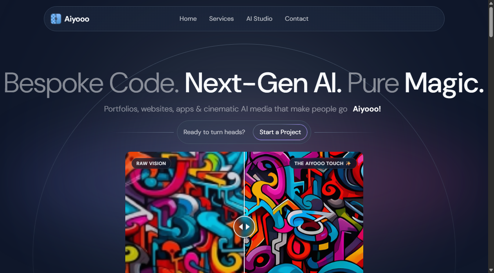
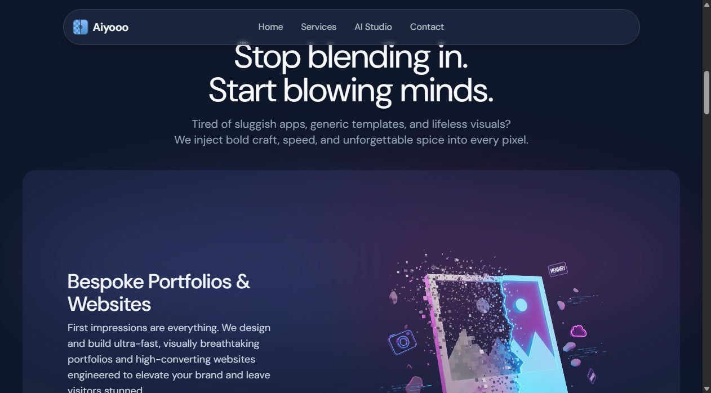
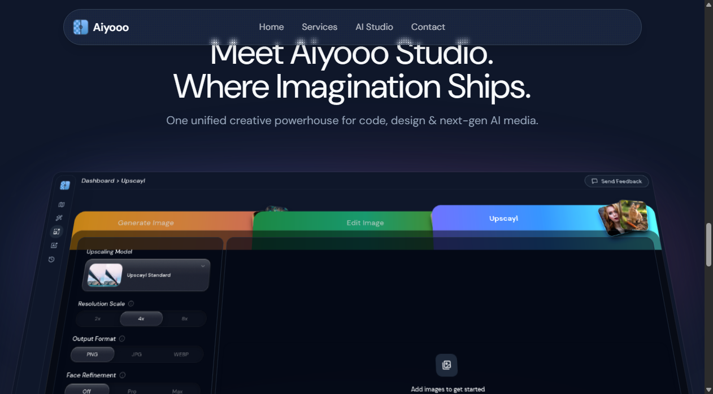
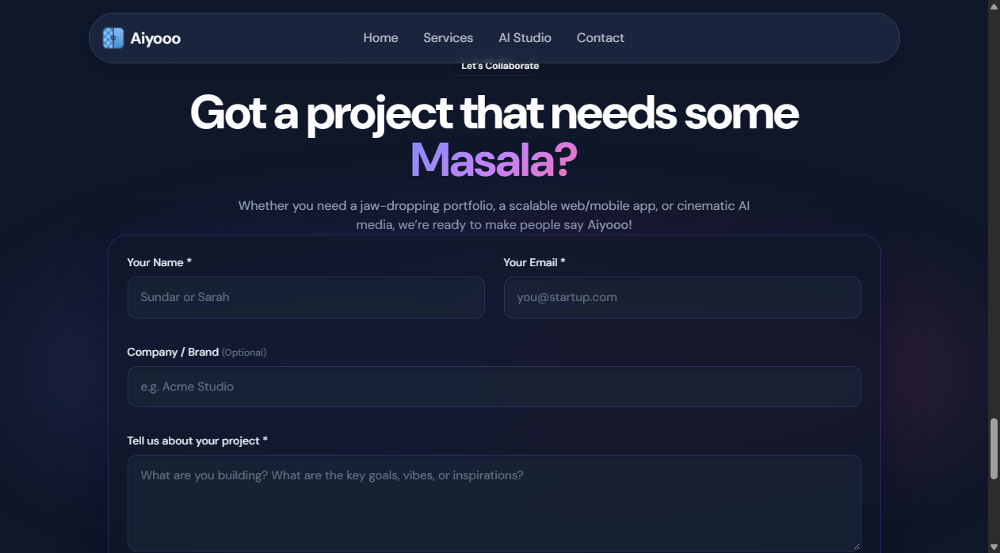

# 🌶️ Aiyooo - Next-Gen Digital Studio Website

<div align="center">

[](https://greensock.com/gsap/)
[](https://lenis.darkroom.engineering/)
[](https://tailwindcss.com/)
[](https://developer.mozilla.org/en-US/docs/Web/JavaScript)
[](LICENSE)

An ultra-modern, high-performance digital studio website template engineered with **GSAP 3D scroll perspective**, **interactive before/after image slider**, **Lenis inertial smooth scrolling**, and a bespoke **midnight indigo glassmorphic UI**.

<br/>



</div>

---

## 📸 Previews

| Hero Showcase & Comparison Slider | Bespoke Craft & Services Grid |
| :---: | :---: |
|  |  |
| **Interactive Before / After Slider** | **Sticky Staggered Card Reveal** |

| 3D Studio Showcase | Midnight Glassmorphic Contact |
| :---: | :---: |
|  |  |
| **3D Scroll Perspective Tilt** | **Responsive Project Dispatcher** |

---

## ✨ Features

- ⚡ **Lenis Inertial Smooth Scrolling**: Buttery-smooth, normalized momentum scrolling synchronized directly with GSAP ScrollTrigger.
- 🎚️ **Interactive Comparison Slider**: Draggable split-screen slider with mouse, touch drag, pointer tracking, and keyboard accessibility.
- 🪐 **GSAP 3D Scroll Perspective**: Dynamic 3D container tilt (`rotateX: 25deg -> -15deg`) and vertical card elevation scrubbed to scroll position.
- 🌀 **Dual Running Text Marquees**: High-impact, full-width running text dividers featuring bullet spacers and directional velocity scrub.
- 🤝 **Infinite Partner Logo Marquee**: Smooth continuously looping press & partner banner with hover-pause behavior.
- 📩 **Midnight Indigo Glassmorphic Contact Hub**: Custom-themed contact form with glowing indigo focus states, interactive validation, and instant dispatch feedback.
- 🧭 **Centered Floating Pill Navbar**: Blur-enhanced glass navigation centered across the viewport with Lenis in-page smooth gliding.
- 📱 **Adaptive Mobile Drawer**: Slide-out responsive mobile navigation with gesture backdrop and quick-action links.
- 🚀 **Zero Build Step Required**: Clean standalone HTML, CSS, and modular JavaScript runnable straight in any browser.

---

## 🎮 Controls & Interactions

| Action | Control / Gesture |
| :--- | :--- |
| **Smooth Navigation** | Mouse wheel or trackpad up / down |
| **Compare Visuals** | Drag slider handle horizontally or use **`Left / Right`** arrows |
| **Quick Jump to Section** | Click **`Home`**, **`Services`**, **`AI Studio`**, or **`Contact`** in the floating navbar |
| **Fast Dispatch** | Click **`Start a Project`** in the hero to glide down to the contact card |
| **Mobile Navigation** | Tap hamburger button on mobile to toggle slide-out drawer menu |

---

## 🛠️ Architecture & Tech Stack

| Technology | Purpose |
| :--- | :--- |
| **HTML5 & Modern CSS** | Semantic layout, CSS backdrop filters, and radial glow atmospheres |
| **Tailwind CSS** | Atomic responsive styling, flexbox grids, and typography scale |
| **GSAP 3.12** | Core timeline animations, intro preloader sequence, and scroll reveals |
| **ScrollTrigger** | Scroll-driven timeline scrubbing, parallax depth, and 3D rotation transforms |
| **Lenis 1.1.18** | Smooth inertial momentum scrolling with RAF synchronization |

---

## 📁 Project Structure

```text
├── index.html                   # Main landing page entry point
├── README.md                    # Project documentation
├── .gitignore                   # Git ignore rules
├── docs/
│   └── screenshots/             # High-resolution documentation previews
│       ├── hero-showcase.png
│       ├── services-grid.png
│       ├── 3d-studio.png
│       └── contact-section.png
└── assets/
    ├── css/
    │   └── style.css            # Core stylesheets and utility classes
    ├── js/
    │   ├── gsap.min.js          # GSAP animation engine fallback
    │   ├── lenis.min.js         # Lenis smooth scroll fallback
    │   └── main.js              # Interactive controller (GSAP, Lenis, slider, navbar, contact)
    └── images/
        ├── logo/                # Brand logo & favicon
        │   └── logo.png
        ├── backgrounds/         # Gradient overlays & glow SVGs
        │   └── bg-gradient.svg
        ├── comparison/          # High-resolution comparison slider images
        │   ├── original.webp
        │   └── upscaled.webp
        ├── features/            # Feature graphics & 3D dashboard preview
        │   ├── cloud-screenshot.webp
        │   ├── desktop-app.png
        │   ├── headache.webp
        │   ├── ring.png
        │   └── upscaling.webp
        └── partners/            # Partner & press logos
            ├── beebom.png
            ├── digitaltrends.png
            ├── geekworkers.png
            ├── gigazine.png
            ├── howtogeek.png
            ├── itsfossnews.png
            ├── linuxuprising.png
            ├── makeuseof.png
            ├── medium.png
            ├── nerdschalk.png
            ├── reddit.png
            └── ycombinator.png
```

---

## 🚀 How to Run

1. **Option A (Instant)**: Double-click `index.html` to open it in your browser.
2. **Option B (Recommended Local Server)**:
   ```bash
   python -m http.server 8000
   ```
   Then open `http://localhost:8000` in your web browser.

---

## 📄 License

MIT License © 2026 [Sooraj Studio](https://github.com/soorajstudio)
